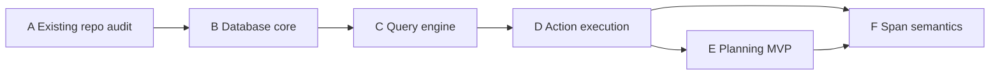

# 実装バックログ案（GitHub Projects 取り込み用）

> 注意: **登録済み Issue ではない**。リポジトリの現行コード・既存 Issue を確認してから、必要なものだけ作成する。各タスクは仕様／テスト／実装を区別する。

## 依存関係

## Epic A — 既存実装と設計の対応

- [ ] **A-01** 既存リポジトリの言語、ビルド、テスト、README、Wiki、Issues、Projects を棚卸しする。
  - Done: コード・テスト・設計ドキュメントの索引がある。
- [ ] **A-02** `Schema / Instance / Query / Eval` の既存実装と新設計の対応表を作る。
  - Done: 再利用可能、要変更、未実装が明記される。
- [ ] **A-03** MVP の最小デモと既存テストを再現する。
  - Done: 環境をセットアップし実行結果を得るか、再現阻害要因を文書化する。

## Epic B — Algebraic Database Core

- [ ] **B-01** type-side を固定した Schema / Instance の内部表現を決める。
  - Done: 定義・サンプル・シリアライズ形式がある。
- [ ] **B-02** 有限インスタンスと整合性チェッカーを実装する。
  - Done: 外部キー・属性・スキーマ等式の正／負例テストが通る。
- [ ] **B-03** エンティティ永続 ID・生成・削除を実装する。
  - Done: 削除・再生成で ID が区別される。
- [ ] **B-04** 属性／外部キー値の置換と等式の検証を分離する。
  - Done: 置換・矛盾・型違反・参照破壊の動作がテストされる。

## Epic C — Query Engine

- [ ] **C-01** `Q=(Γ,Φ)` の型付き構文とパース／構築 API を用意する。
  - Done: 等式連言を AST で表現できる。
- [ ] **C-02** Frozen instance の構築を実装する。
  - Done: 小例で商と型が正しい。
- [ ] **C-03** `Hom(F_Q,I)` に対応するマッチ列挙を実装する。
  - Done: 真／偽／複数マッチを検証できる。
- [ ] **C-04** 非単射マッチ・等式制約・固定 type-side をテストする。
  - Done: 反例と境界条件のテストがある。
- [ ] **C-05** RETURN 射影と lazy enumeration を実装する。
  - Done: マッチ証人と結果射影を区別できる。

## Epic D — Action Execution

- [ ] **D-01** `Create/Delete/Set` の AST と Entity/Equation Patch 表現を定義する。
  - Done: 競合・不正な Patch を表現または拒否できる。
- [ ] **D-02** マッチから Symbolic Patch を生成する。
  - Done: 対象 ID・値をマッチに結び付けられる。
- [ ] **D-03** Concrete Patch への具体化・新 ID の割当てを実装する。
  - Done: ID が衝突せず再利用されない。
- [ ] **D-04** Patch validate を実装する。
  - Done: 全域性・等式・dangling 等の負例を拒否する。
- [ ] **D-05** Atomic Patch apply を実装する。
  - Done: 失敗時に部分変更が残らない。
- [ ] **D-06** `execute` と遅延 `successors` を実装する。
  - Done: 全マッチに対応する後続状態を列挙できる。

## Epic E — Planning MVP

- [ ] **E-01** ゴールを frozen query の非空性として判定する。
  - Done: 初期状態での達成／未達を判定できる。
- [ ] **E-02** BFS で前向き探索する。
  - Done: 既知の短いプランを発見できる。
- [ ] **E-03** 状態重複検出と追跡情報を導入する。
  - Done: 有限状態のループを防止できる。
- [ ] **E-04** プラン・実行事象・検証可能な trace を出力する。
  - Done: 初期状態から全ステップを再現できる。
- [ ] **E-05** Blocks World を実装する。
  - Done: 少なくとも2ステップのプランで最終ゴール達成。
- [ ] **E-06** Logistics を追加し PDDL との差を記録する。
  - Done: 第二ドメインで同じ実行 API が使える。

## Epic F — 数学的意味論の検証

- [ ] **F-01** `(source, match, target)` などの実行事象を定義する。
  - Done: 同じ前後状態の異なる実行証人を保持できる。
- [ ] **F-02** 実行の $W\leftarrow E_a\rightarrow W$ を構成する。
  - Done: 小さな有限例で始点・終点が検証可能。
- [ ] **F-03** pullback によるイベント合成を構成する。
  - Done: 2ステップ実行 trace と対応する。
- [ ] **F-04** span の関係への抽象化を検証する。
  - Done: 各前後状態対の到達可能性と整合する。
- [ ] **F-05** 具体的遷移と数学的意味論の対応テストを追加する。
  - Done: 回帰テストとして CI で実行できる。

## Project 推奨フィールド

- **Status**: Backlog / Ready / In progress / Blocked / Done
- **Track**: Implementation / Design / Research / Verification
- **Epic**: A–F
- **Priority**: 当面は A, B, C, D, E の依存順。研究 F は小例の完成後。
- **Acceptance**: 各項目本文の Done 条件

## Issue 登録を急がない事項

Lazy saturation、Doctrine/Hyperdoctrine、monad instances、異なるスキーマの貼り合わせ、真の並行性、HTN、PbR、SMT 統合などは [research-roadmap.md](research-roadmap.md) に保存する。実装要件と依存関係が明確になったら Issue 化する。
