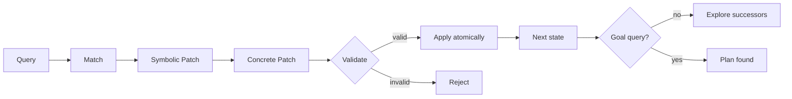

# 目的・基本方針・アーキテクチャ

## ビジョン

**Algebraic Database を共通の基盤に、(1) 自動プランニングと (2) 形式的システム設計・検証を展開する。** 等式推論、項書換え、クエリ、状態遷移を統合するが、それぞれの数学的意味と実装上の役割を混同しない。

現在の Rust `main` には `src/eval.rs`、`src/instance.rs`、`src/completion/` などの実装が存在する。ただし正確な完成度とテスト結果は未検証である。方向性が不明確だった点に対して、今回は **「どんな状態があり、何をしたらどの状態に移るかを定義し、ゴールに到達する計画を求める」** を最小の具体用途とする。

## 用途の二本柱

### Planning

- 初期状態、適用可能なアクション、ゴールクエリを記述する。
- 状態更新を繰り返し、ゴールに到達するアクション列を求める。
- Blocks World、Logistics から評価し、PDDL/STRIPS や Powerlifted などと比較する。
- 将来は効用・最適化、HTN、PbR、記号状態探索、SAT/SMT を考える。

### Formal system design / verification

- 個々のシステムをスキーマ、インスタンス、アクション、制約として記述する。
- 独立系または共有インターフェースを持つ系を合成し、合成後の制約保持や安全性・活性を調べる。
- 領域固有の記述と、検証したい性質、実行順序・因果性の記述を区別する。
- モデル検査、動的論理、Assume–Guarantee などへの拡張は後続課題。

## レイヤー

| レイヤー | 基本対象 | 役割 |
| --- | --- | --- |
| Schema / Types | スキーマ $S$、固定 type-side | 型、関数記号、等式公理 |
| Instance | $I \in S\text{-Inst}$ | 現在の世界の事実・個体と値 |
| Equality | $I\models t=u$ | インスタンス内部での等式推論 |
| Query | frozen instance $F_Q$、$\mathrm{Hom}(F_Q,I)$ | 適用対象とゴールの照合 |
| Action | query + update | 実行可能条件と状態変更 |
| Execution | concrete patch, $I\xrightarrow{a}J$ | 原子的・整合的な状態遷移 |
| Search | 後続状態の生成・探索 | 計画発見 |
| Semantics | $W\leftarrow E_a\rightarrow W$ | 実行事象と合成の構造 |
| Logic | Doctrine / modalities | 性質、到達性、検証 |
| Integration | スキーマ pushout・状態 pullback 等 | 複数システムの接続 |

「等式の証明」と「アクションによる更新」は異なる演算。等式を追加して飽和させる処理を、既存値の変更の代わりにしない。

## 一つの実行の流れ

## モジュール境界（命名は仮）

- `Schema` / `Instance` / `EqualityEngine`
- `FrozenQuery` / `Matcher`
- `Patch` / `PatchValidator` / `PatchApplier`
- `ActionExecutor` / `Successors`
- `GoalEvaluator` / `Search`
- `EventSemantics` / `Span`

既存の実装言語は **Rust** (`Cargo.toml`, edition 2021)。`src/eval.rs` には Query / QueryEntity / eval があり、`src/instance.rs` は Instance を保持する。上記の新規インターフェース名は未実装を含む**提案**である。Curry の lazy saturation、Maude / Maude-SE、Java の実装調査は以前検討した研究候補であり、この PR は言語変更を決めない。
